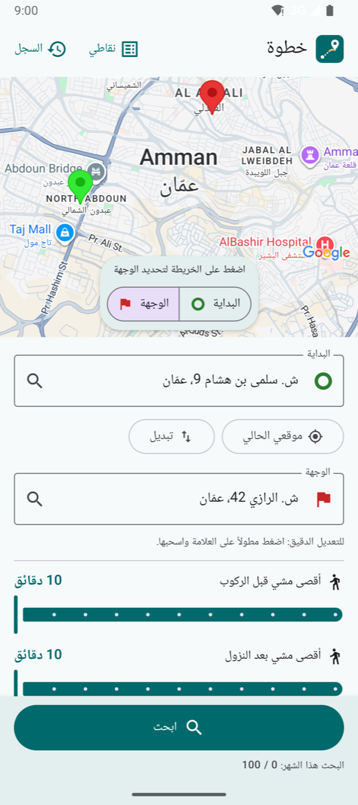
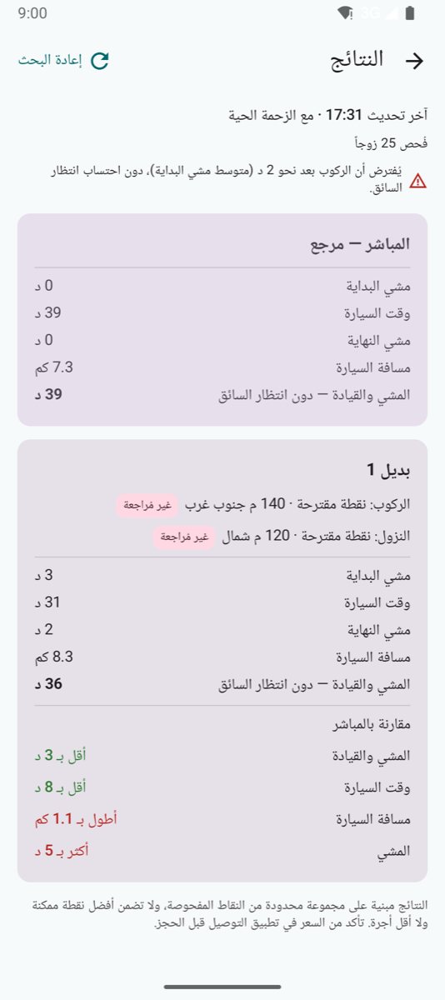
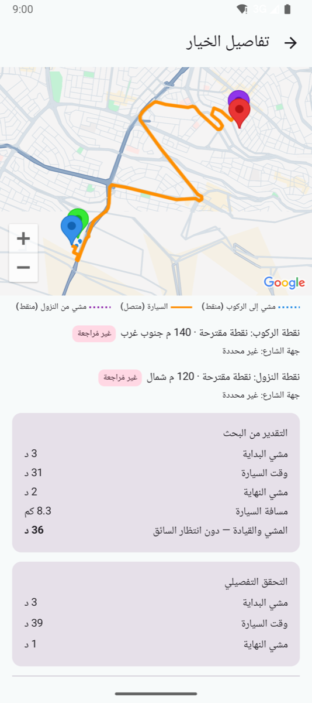

<p align="center">
  
</p>

<h1 align="center">Khatwa · خطوة</h1>

<p align="center">
  Walk a few steps, ride the rest.<br>
  An Android app that finds a better pickup and dropoff point for your ride-hailing trip.
</p>

<p align="center">
  
  
  
  
</p>

---

Sometimes the door-to-door ride isn't the fastest one. If you walk two minutes to the other side of a divided road, or get dropped off one block early, the driver can skip a U-turn, a one-way loop, or a traffic jam. Khatwa checks the nearby pickup and dropoff points and tells you which pair saves time or distance compared with the direct trip.

The UI is in Arabic (RTL), and the walking heuristics are tuned for Amman's hills and divided roads.

## Screenshots

<p align="center">
  
  &nbsp;
  
  &nbsp;
  
</p>

<p align="center">
  <sub><b>Plan</b>: set start, destination and how far you'll walk &nbsp;·&nbsp; <b>Results</b>: alternatives compared with the direct ride &nbsp;·&nbsp; <b>Detail</b>: walk and drive legs on the map</sub>
</p>

## Features

- **Pick start and destination** by tapping the map, searching places, or using your current location.
- **Walking limits**: set the most you'll walk before pickup and after dropoff (0–10 min each).
- **Three ranking goals**: total trip time (walk + drive), drive time only, or drive distance only.
- **Honest comparison**: every alternative is shown next to the direct door-to-door trip, with the difference in total time, drive time, distance and walking. Options that are worse on every metric are dropped.
- **Traffic-aware**: drive times use live traffic, departing when you'd actually reach the pickup point.
- **Saved points**: keep your own reviewed pickup/dropoff spots with road side and a nearby landmark. When you have none, the app suggests points on nearby roads automatically.
- **Report bad points**: mark a point as wrong side of the road or unsafe to stop, and it's excluded from future searches.
- **Fare log**: record the price the ride app quoted for the direct trip and for the alternative, so you can see over time whether it actually saves money.
- **Cost guard**: a monthly search cap (100 searches) and at most 25 drive-matrix elements per search keep Google Maps billing predictable.

## How it works

1. Up to 5 candidate points per side are picked: the exact start/destination, then your saved points nearest-first, then auto-suggested points snapped to roads (Roads API) in rings around you.
2. Walking times to each candidate come from the Routes API walk matrix. Candidates over your walking limit are dropped before any drive elements are requested.
3. A traffic-aware drive matrix covers every remaining pickup × dropoff pair.
4. [`Engine.rank`](app/src/main/java/com/haithamassoli/khatwa/Engine.kt) keeps only the Pareto-optimal pairs that beat the direct trip on your chosen goal, and returns the top 3.

The ranking engine is plain Kotlin with no Android dependencies and has unit tests.

## Getting started

### Requirements

- Android Studio (recent, with AGP 9.x support)
- JDK 17
- A device or emulator on Android 12 (API 31) or newer
- A Google Maps Platform API key

### Google Maps API key

Enable these APIs in your Google Cloud project:

- Maps SDK for Android
- Routes API
- Roads API
- Places API (New)
- Geocoding API

Then add the key to `local.properties` in the project root (this file is git-ignored):

```properties
MAPS_API_KEY=your_api_key_here
```

> [!TIP]
> Restrict the key to your app's package name (`com.haithamassoli.khatwa`) and SHA-1 certificate fingerprint, and limit it to the APIs above.

### Build and run

```bash
git clone https://github.com/haithamassoli-plus-connect/Khatwa.git
cd Khatwa
./gradlew installDebug
```

Or open the project in Android Studio and press **Run**.

### Tests

```bash
./gradlew testDebugUnitTest
```

## Project structure

```
app/src/main/java/com/haithamassoli/khatwa/
├── MainActivity.kt      # Entry point, forces RTL, screen switch
├── MainViewModel.kt     # UI state and actions
├── Model.kt             # Shared data types (seconds and meters everywhere)
├── Engine.kt            # Pure ranking logic (Pareto filter + sort)
├── Searcher.kt          # Candidate selection, matrix calls, quota
├── Google.kt            # Google Maps Platform REST client
├── Store.kt             # Local JSON storage for points, fares, quota
├── PlanScreen.kt        # Start/destination/walk limits
├── ResultsScreen.kt     # Direct vs. alternatives
├── DetailScreen.kt      # Route map + fare logging
├── PointsScreen.kt      # Saved points
└── HistoryScreen.kt     # Fare history
```

## Privacy

There's no backend and no account. Saved points, fare history and the quota counter are stored as JSON files in the app's private storage on your device. Coordinates are sent only to Google Maps Platform to calculate routes.

## Disclaimer

Results come from a limited set of sampled points and don't guarantee the best possible spot or the lowest fare. Check the price in your ride-hailing app before booking, and make sure the pickup spot is safe and legal to stop at.
